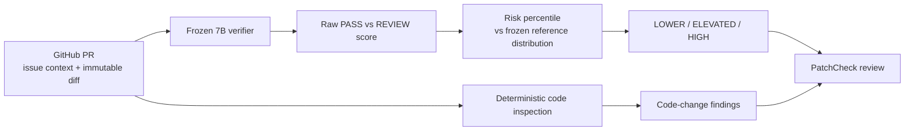
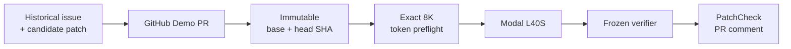

# PatchCheck

**A small learned verifier for advisory pull-request triage under distribution shift.**

PatchCheck studies a deliberately narrow question:

> **Can a relatively small code model learn a useful signal for distinguishing correct and incorrect software patches from an issue description and candidate diff alone?**

The current answer is **partially**.

Fine-tuning produces a strong improvement on familiar held-out data and remains useful across unseen repositories and a held-out agent family. The advantage becomes much smaller on structurally matched hard cases and on an independent external review set.

PatchCheck therefore does **not** approve patches, auto-merge code, or claim to verify arbitrary pull requests correctly.

Instead, it exposes the part of the signal that survived evaluation as an **advisory review-priority score**, while keeping deterministic code-change findings separate.

---

## At a glance

* **Model:** Qwen2.5-Coder-7B-Instruct + QLoRA adapter
* **Model input:** issue description + candidate patch
* **Training population:** 11,742 execution-labeled candidate patches
* **Primary control:** the same frozen 7B base model used zero-shot
* **Evaluation:** familiar held-out, repository OOD, agent-family OOD, structurally matched hard cases, and an external review set
* **Uncertainty:** 10,000 paired nonparametric bootstrap resamples over frozen seed-17 predictions
* **Deployment:** GitHub Actions + scale-to-zero Modal GPU inference
* **Safety posture:** advisory only; model failures and oversized inputs fail unavailable rather than low-risk
* **Public Action:** deterministic code-change inspection only; hosted model inference remains maintainer-gated

---

## Why this project

Coding agents can produce patches quickly.

Verification is harder.

A patch may look plausible while:

* only partially solving the requested behavior,
* breaking an adjacent code path,
* removing validation,
* modifying an API contract,
* overfitting to a narrow test,
* or introducing a regression outside the immediate change.

The tempting solution is to place another large LLM behind the coding agent and ask whether the patch is correct.

PatchCheck tests a more constrained alternative:

```text
issue description
        +
candidate patch
        |
        v
small frozen verifier
        |
        v
review-priority signal
```

This constraint is intentional.

The verifier does not execute the candidate patch, browse the repository, or receive hidden harness outcomes at inference time. Its learned score must come from the relationship between the stated issue and the proposed code change.

That also defines the limitation: some correctness properties simply cannot be recovered reliably from issue + patch alone.

---

# Experimental result

The primary baseline is the **same Qwen2.5-Coder-7B-Instruct model used zero-shot**, with the same prompt, score definition, tokenizer policy, and frozen evaluation populations.

This isolates the effect of fine-tuning more cleanly than comparing unrelated model families.

## ROC-AUC

| Evaluation setting             | Zero-shot | Fine-tuned |           Δ |       95% CI for Δ |
| ------------------------------ | --------: | ---------: | ----------: | -----------------: |
| Familiar held-out tasks        |    0.6058 | **0.8200** | **+0.2142** | [+0.1867, +0.2418] |
| Unseen repositories            |    0.5670 | **0.7479** | **+0.1809** | [+0.1554, +0.2071] |
| Unseen agent family            |    0.5176 | **0.6751** | **+0.1575** | [+0.1115, +0.2024] |
| Shortcut-controlled hard cases |    0.5326 | **0.5972** | **+0.0645** | [+0.0325, +0.0959] |
| External review set            |    0.6191 | **0.6540** | **+0.0349** | [+0.0003, +0.0691] |

## Unsafe PR-AUC

| Evaluation setting             | Zero-shot | Fine-tuned |           Δ |       95% CI for Δ |
| ------------------------------ | --------: | ---------: | ----------: | -----------------: |
| Familiar held-out tasks        |    0.9007 | **0.9656** | **+0.0649** | [+0.0546, +0.0756] |
| Unseen repositories            |    0.8438 | **0.9121** | **+0.0684** | [+0.0565, +0.0802] |
| Unseen agent family            |    0.5460 | **0.7080** | **+0.1620** | [+0.1178, +0.2022] |
| Shortcut-controlled hard cases |    0.5261 | **0.5900** | **+0.0639** | [+0.0327, +0.0955] |
| External review set            |    0.6030 | **0.6264** |     +0.0233 | [-0.0151, +0.0613] |

The most important result is not the highest number.

It is the **generalization pattern**:

```text
familiar
   ↓
new repository
   ↓
new agent family
   ↓
structurally matched hard cases
   ↓
external transfer
```

The fine-tuned verifier consistently improves over its zero-shot control, but the advantage shrinks as the evaluation becomes less similar to the training distribution.

The external unsafe PR-AUC confidence interval crosses zero, so that improvement is **not treated as conclusive**.

This is why PatchCheck is framed as a triage signal rather than a universal patch-correctness classifier.

Detailed tables are available in [`docs/evaluations.md`](docs/evaluations.md).

---

# Did the model just learn shortcuts?

That was one of the central failure modes tested during development.

A verifier could appear effective by learning features such as:

```text
large patch -> unsafe
many files -> unsafe
certain repository -> unsafe
certain generator -> unsafe
```

rather than reasoning about whether the patch actually addresses the issue.

To make those shortcuts less useful, the hard evaluation uses **same-task SAFE/UNSAFE matches** selected to be structurally similar.

The frozen hard-match evaluation contains:

* 1,000 matched SAFE/UNSAFE pairs,
* 2,000 candidate patches,
* 464 underlying software tasks,
* exact changed-file-count matching,
* median changed-line ratio of 1.0,
* median token-length ratio of approximately 0.987.

On this set:

| Signal                       |    ROC-AUC |
| ---------------------------- | ---------: |
| Structural shortcut baseline |     0.4974 |
| Metadata shortcut baseline   |     0.5011 |
| Zero-shot 7B                 |     0.5326 |
| **Fine-tuned verifier**      | **0.5972** |

The result does **not** show strong universal semantic verification—the absolute ROC-AUC remains modest.

It does show that the learned signal cannot be explained only by the simple structural and metadata shortcuts measured here.

---

# What PatchCheck claims — and what it does not

### Supported by the current evidence

PatchCheck's frozen experiment supports the narrower claim that:

> Fine-tuning a 7B code model on execution-grounded patch outcomes learns a non-trivial issue↔patch ranking signal that survives repository shift, agent-family shift, and a structurally controlled evaluation, although the effect weakens substantially under harder transfer.

### Not supported

The current evidence does **not** justify claims that PatchCheck:

* determines whether arbitrary code is correct,
* proves semantic understanding,
* replaces repository tests,
* safely approves or merges pull requests,
* generalizes equally across all repositories or coding agents,
* or produces a calibrated probability that a patch is correct.

Those distinctions are intentional product constraints, not omitted caveats.

---

# Architecture



The learned and deterministic paths are independent.

## Learned signal

The model receives:

```text
[ISSUE]
issue description

[PATCH]
candidate diff
```

and compares the sequence likelihood of two frozen verdicts:

```text
PASS
REVIEW
```

The resulting unsafe score is mapped to a **risk percentile relative to a frozen reference distribution**.

PatchCheck exposes that percentile as:

```text
LOWER
ELEVATED
HIGH
```

It is a ranking / triage signal, not a probability of correctness.

## Deterministic findings

The CPU analyzer independently inspects code changes for review-relevant patterns such as:

* public API changes,
* authentication or authorization changes,
* workflow/configuration changes,
* dependency changes,
* removed assertions or exception handlers,
* broad exception handlers,
* dynamic code execution,
* shell-enabled subprocesses,
* test-disabling markers,
* secret-like literals,
* and production Python modifications without corresponding test-file changes.

These findings are evidence for human review, not model features.

---

# Why the two signals stay separate

I explicitly tested whether combining deterministic findings with the learned score would improve the hard evaluation.

It did not.

On the frozen shortcut-controlled set:

```text
model only unsafe PR-AUC       = 0.5900
model + deterministic signal   = 0.5150
difference                     = -0.0750
95% CI                         = [-0.0981, -0.0559]
```

Instead of keeping the more complicated system because it sounded better, PatchCheck rejected the fusion.

The deployed interface therefore presents:

```text
learned review-priority signal
+
independent deterministic findings
```

without allowing one to silently modify the other.

---

# Live GitHub replay demos

The open `[Demo]` pull requests replay historical open-source issue/candidate-patch pairs through the actual deployed GitHub workflow.



| Demo                                                                         | Frozen reference | PatchCheck |
| ---------------------------------------------------------------------------- | ---------------- | ---------- |
| [#13 — more-itertools](https://github.com/tkim602/PatchCheck/pull/13)        | SAFE             | `LOWER`    |
| [#14 — pandas](https://github.com/tkim602/PatchCheck/pull/14)                | SAFE             | `LOWER`    |
| [#15 — pynetdicom](https://github.com/tkim602/PatchCheck/pull/15)            | UNSAFE           | `ELEVATED` |
| [#16 — moto](https://github.com/tkim602/PatchCheck/pull/16)                  | UNSAFE           | `HIGH`     |
| [#17 — flake8-comprehensions](https://github.com/tkim602/PatchCheck/pull/17) | SAFE             | `LOWER`    |

These examples demonstrate **deployment**, not generalization.

Four are frozen training examples and one is a familiar held-out example. They were selected before demo inference and their provenance is recorded in [`docs/demo-cases.json`](docs/demo-cases.json).

The generalization claim comes from the frozen evaluation sets above—not from five successful-looking demo PRs.

---

# Failure behavior

PatchCheck is designed to fail conservatively.

The model workflow does not silently convert missing evidence or infrastructure failure into a low-risk result.

Examples include:

```text
MODEL_NOT_RUN: OVER_8192
MODEL_NOT_RUN: INSUFFICIENT_CONTEXT
MODEL_NOT_RUN: PREFLIGHT_FAILED
MODEL_NOT_RUN: MODAL_FAILED
```

Inputs above 8,192 tokens are rejected rather than silently truncated.

Model artifacts, prompt identity, calibration data, and base-model revision are hash- or revision-pinned before scoring.

The workflow also records the exact PR base and head SHAs used for analysis.

---

# Try it on your repository

## Public CPU Action

The reusable GitHub Action performs deterministic code-change inspection without executing code from the pull request.

```yaml
name: PatchCheck

on:
  pull_request:

permissions:
  contents: read
  issues: read
  pull-requests: read

jobs:
  inspect:
    runs-on: ubuntu-latest

    steps:
      - uses: actions/setup-python@v7
        with:
          python-version: "3.12"

      - uses: tkim602/PatchCheck@main
        with:
          github-token: ${{ github.token }}
          pull-request-number: ${{ github.event.pull_request.number }}
```

It:

```text
collects immutable PR input
        ↓
parses the diff
        ↓
performs deterministic inspection
        ↓
writes JSON + Markdown output
        ↓
adds the report to the GitHub Actions summary
```

It does **not** run the 7B model.

## Hosted verifier

The GPU-backed verifier remains **maintainer-gated** rather than operating as an unrestricted public inference endpoint.

For this repository, it can run through approved demo PRs, an explicit model label, or manual workflow dispatch.

This prevents arbitrary PR authors from spending GPU resources and keeps the deployment claim separate from offering a hosted service.

---

# CI and deployment

PatchCheck uses separate workflows for different trust boundaries.

| Workflow                                                                 | Trigger             | Purpose                                           |
| ------------------------------------------------------------------------ | ------------------- | ------------------------------------------------- |
| [`ci.yml`](.github/workflows/ci.yml)                                     | push / PR           | package installation + tests                      |
| [`changeguard-evidence.yml`](.github/workflows/changeguard-evidence.yml) | PR                  | immutable PR collection + deterministic analysis  |
| [`changeguard-full.yml`](.github/workflows/changeguard-full.yml)         | gated PR / dispatch | tokenizer preflight + Modal inference + PR report |
| [`secret-scan.yml`](.github/workflows/secret-scan.yml)                   | push / PR           | secret scanning                                   |

The GPU workflow checks out the trusted default branch rather than executing code from the candidate PR.

Model inference happens against collected PR text and diff data.

---

# Local development

The CPU analyzer has no runtime package dependencies beyond Python.

```bash
python3 -m venv .venv
. .venv/bin/activate

python -m pip install -e '.[dev]'

pytest
```

Offline analysis accepts a collected PR payload containing:

```text
patch
before_after
base_sha
head_sha
```

Run:

```bash
python -m patchcheck.github_demo analyze \
  --input pr.json \
  --output patchcheck.json \
  --markdown patchcheck.md
```

---

# Reproducibility

The deployed verifier is frozen around:

```text
Base model:
Qwen/Qwen2.5-Coder-7B-Instruct

Base revision:
c03e6d358207e414f1eca0bb1891e29f1db0e242

Training examples:
11,742

Primary training/evaluation seed:
17

Maximum input length:
8,192 tokens
```

The deployment verifies the adapter, adapter configuration, prompt, and calibration artifacts with SHA-256 fingerprints before scoring.

Evaluation confidence intervals use 10,000 paired nonparametric bootstrap resamples over the frozen predictions.

The intervals quantify uncertainty from the evaluated sample.

They do **not** quantify variation across independent training seeds, because the currently deployed FT06 result is a frozen seed-17 model.

Training/evaluation datasets, model weights, and private experiment archives are not currently distributed through this repository.

---

# Limitations

PatchCheck's strongest limitation is also the boundary of the experiment:

> **The learned verifier only sees the issue and candidate patch.**

It does not receive the full repository state, runtime execution, dependency behavior, hidden tests, or an agent trajectory.

As a result:

1. correctness that depends on unseen repository context may be impossible to infer reliably;
2. performance declines under stronger distribution shift;
3. absolute hard-match and external performance remains modest;
4. a high or low percentile should affect review priority, not replace engineering judgment;
5. execution-derived labels are stronger than LLM-judge labels but tests are still an incomplete oracle;
6. the reported bootstrap intervals do not measure training-seed variance;
7. the current external result supports only modest transfer, not universal generalization.

These are the reasons PatchCheck remains advisory.

---

# Research takeaway

The project started with a stronger hypothesis than the final evidence supported:

> perhaps a small fine-tuned model could serve as a broadly reliable patch verifier.

The experiments produced a more limited result.

Fine-tuning clearly improved ranking inside the frozen experimental setup, and part of that improvement survived repository shift, agent-family shift, and structural shortcut control.

But the advantage attenuated substantially on harder and more external evaluations.

That changed the system design.

Instead of converting the model into an automatic merge gate, PatchCheck exposes the validated signal as review prioritization and explicitly reports when it does not have enough evidence to score a pull request.

For this project, **learning where the model stops being reliable is part of the result.**

---

## License

PatchCheck source code is released under the [MIT License](LICENSE).

Third-party code and replay-demo attribution are documented separately in [`THIRD_PARTY_NOTICES.md`](THIRD_PARTY_NOTICES.md) and [`third_party_licenses/`](third_party_licenses/).
